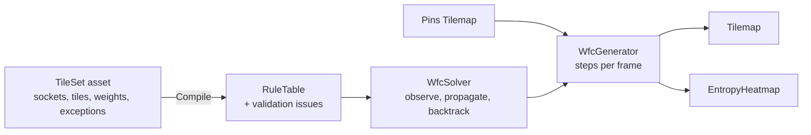

# WFC Studio

**Designer-friendly procedural map generation for Unity 6, built on the Wave Function Collapse algorithm.**

[](https://github.com/SoniSeli/WFC-Studio/actions/workflows/tests.yml)


**[Play the demo in your browser](https://soniseli.itch.io/map-generator-wfc)** on itch.io.

WFC Studio is a from-scratch rewrite of the Unity tool I built for my Computer Science bachelor's thesis,
*Map Generator using Wave Function Collapse Algorithm* ([itch.io page and thesis PDF](https://soniseli.itch.io/map-generator-wfc)).
The thesis tackled the content bottleneck in game development: designers need more levels than they can build by hand.
This version keeps that goal and rebuilds the tool to production standards: a deterministic, tested solver,
validated tile rules, and editor tooling a designer can use without writing code.

## Features

- **Deterministic solver in plain C#**: same seed, same map, on every platform. No `UnityEngine` dependency, fully unit tested.
- **Weighted entropy and backtracking**: control how often each tile appears, and recover from contradictions instead of restarting.
- **Edge sockets instead of neighbour lists**: label each tile edge, and connected sockets may touch. Rules can never be one-sided, and a new tile needs only its own four labels. Socket connections express layout rules. For example, a `border` that faces grass but not another border keeps features apart. Exceptions cover the special cases, such as a minimum feature size.
- **Validated tile sets**: tile sets are ScriptableObject assets. The checker explains problems in plain language, such as an unknown socket, a tile that can only appear at the map edge, or conflicting exceptions, and fixes the clear-cut ones in one click.
- **WFC Studio editor window**: browse a tile set's tiles, weights and allowed neighbours, paint the tiles you want fixed with the Tile Palette, then let WFC fill in the rest. Generates in Edit mode, live or instantly, with full Undo.
- **Live visualization**: watch the map collapse step by step, with an entropy heatmap overlay.
- **Fast and allocation-free**: a 100×100 map with all 61 sample tiles solves in about 58 ms in the Editor, with no garbage-collector allocations while solving. See [docs/BENCHMARKS.md](docs/BENCHMARKS.md).

## Installing

Requires Unity **6000.0** (Unity 6 LTS) or later. In Unity, open **Window → Package Manager → + → Install package from git URL**, then enter:

```
https://github.com/SoniSeli/WFC-Studio.git?path=/Packages/com.soniseli.wfc#v1.0.0
```

The package depends only on Unity's 2D Tilemap package, which the Package Manager installs with it.

### Samples

Select **WFC Studio** in the Package Manager, open **Samples**, and import:

- **Puny World Tile Sets**: six tile sets (meadow, lakes, forests, mountains, castles and all of them together) with a ready-to-run scene. No other packages needed.
- **Live Demo**: the browser demo's scene and UI. It needs the Puny World Tile Sets sample, the Input System and URP.

## Quick start

1. Import the **Puny World Tile Sets** sample and open its **Puny World** scene.
2. Open **Window → WFC Studio**. It picks up the scene's generator.
3. Click **Generate** to watch a map fill in, or **Instant** to solve it at once. **Ctrl+Z** undoes the map.
4. To fix tiles in place, use **Create Tile Palette**, then **Paint Pins**, paint a few tiles, and generate again.
5. To make your own rules, use **Create → WFC Studio → Tile Set**, add socket labels and tiles, and check the window's **Validation** section.

From code:

```csharp
var generator = GetComponent<WfcGenerator>();
generator.Seed = 42;
generator.GenerateInstantly(); // or Generate() to watch it run from Update
```

## How it works



The package is split into three assemblies, and tests enforce the layering:

| Assembly | What it holds | Depends on |
|---|---|---|
| `WfcStudio.Core` | The solver, rule tables, sockets and validation, in plain C# | Nothing (no `UnityEngine`) |
| `WfcStudio.Runtime` | Tile set assets, the generator component, heatmap and pop animation | Core |
| `WfcStudio.Editor` | The WFC Studio window and edit-mode generation | Core, Runtime |

Each step picks the undecided cell with the lowest entropy (from an indexed heap), chooses one of its tiles by weight, and
propagates the rules outward. On a contradiction, the solver undoes the latest choice exactly from a trail of removals,
bans that tile there and tries again, restarting with a new random stream only if its backtracking budget runs out.

## Repository layout

```
WFC-Studio/
├─ Packages/com.soniseli.wfc/   The tool, as a UPM package
│  ├─ Runtime/Core/             WfcStudio.Core: solver, plain C#
│  ├─ Runtime/Unity/            WfcStudio.Runtime: assets, Tilemap output, visualization
│  ├─ Editor/                   WfcStudio.Editor: WFC Studio window, edit-mode generation
│  ├─ Samples~/                 Importable samples, exported from the folders below
│  └─ Tests/Editor/             WfcStudio.Tests: EditMode tests
├─ Assets/Demo/                 Demo scene: UI Toolkit panel, live generation, entropy heatmap
├─ Assets/Samples/PunyWorld/    Sample tile sets: Meadow, Lake, Forest, Mountain, Castle, Overworld
├─ Assets/Dev/Editor/           Tools that rebuild the samples, demo scene and README GIF from code, measure them, and make WebGL builds
├─ Assets/Tests/Editor/         Tests that every sample validates and generates
├─ Assets/Tests/Performance/    Solver benchmarks (Performance Testing package), see docs/BENCHMARKS.md
└─ .github/workflows/           CI: EditMode tests on Unity 6.3, and the package alone in an empty Unity 6.0 project
```

## Development

- Unity **6000.3.25f1** (6.3 LTS). Open the repository root with Unity Hub, then open `Assets/Demo/Demo.unity` and press Play.
- Demo controls: pick a tile set, size and seed, then **Generate** to watch it run or **Instant** to solve in one go. Shortcuts: **Space** pauses, **N** steps, **G** generates, **R** picks a new seed.
- Run tests from **Window → General → Test Runner → EditMode**, or from a terminal with the Unity CLI:
  `unity test . --mode EditMode`

## Credits

- Wave Function Collapse was created by Maxim Gumin: [mxgmn/WaveFunctionCollapse](https://github.com/mxgmn/WaveFunctionCollapse).
- Sample tile art: [16x16 Puny World](https://merchant-shade.itch.io/16x16-puny-world) by merchant-shade, a rework of [16x16 Mini World Sprites](https://merchant-shade.itch.io/16x16-mini-world-sprites) by Kurt Gabriel Sotelo and octoshrimpy. Both are CC0; see [THIRD-PARTY-NOTICES.md](THIRD-PARTY-NOTICES.md).

## License

[MIT](LICENSE) © 2026 Soni Seli
